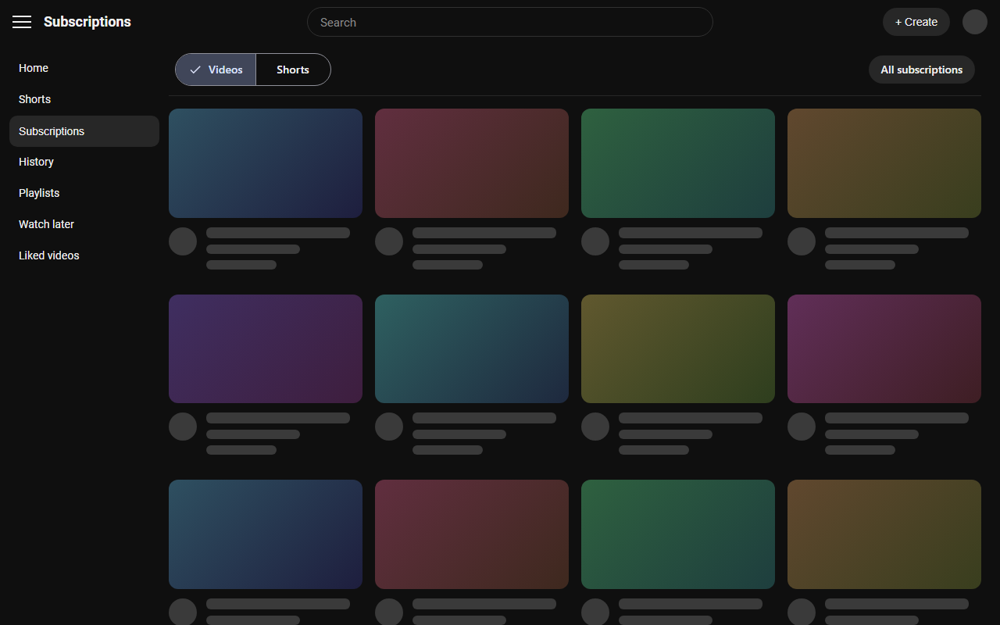

# Everything for YouTube

A Chrome extension with optional YouTube features. **Every feature can be switched on or off** from the extension's popup, and changes apply straight away without reloading the page.

## Subscriptions page

- Removes the "Most relevant" section and other injected shelves
- Adds a sticky **Videos | Shorts** tab bar that switches the page in place; the Videos tab hides Shorts mixed into the grid
- Keeps "All subscriptions" on the same row as the tabs
- Matches YouTube's light or dark theme

## Watch2Gether

- Hover a video thumbnail and click the **W** button to add that video to your Watch2Gether room's playlist (off by default, see below)



*Illustration with placeholder content, not a capture of a real account.*

## Install

1. Open `chrome://extensions`
2. Turn on **Developer mode** (top right)
3. Click **Load unpacked** and select this folder
4. Reload YouTube, then click the extension's toolbar icon to choose your features

## Watch2Gether setup

1. Get an API key from your Watch2Gether account's API page.
2. Open the extension popup and switch on **Add-to-W2G button**. Chrome asks for access to `w2g.tv`; this is requested only when you turn the feature on and is handed back when you turn it off.
3. Paste your API key and your room's streamkey or URL, then **Save**.

Your API key and room stay in your browser's local extension storage and are never synced. "Forget saved key and room" in the popup removes them. See [PRIVACY.md](PRIVACY.md).

## Adjusting

If YouTube adds another section you want gone, add its heading text
(lower-case) to the `blocked` list in `HEADINGS` at the top of
`content/subs-cleaner.js`, then click the reload icon on the extension card in
`chrome://extensions`.

## Development

Requires Node.js. The extension itself has no dependencies; npm is only used
for tooling.

```sh
npm install
npm run lint      # ESLint
npm run package   # builds dist/everything-for-youtube-<version>.zip for the Web Store
```

```text
manifest.json
background/   service worker (Watch2Gether requests, permission sync)
content/      subs-cleaner.*  Subscriptions page features
              w2g/            thumbnail button and site adapter
popup/        settings popup
lib/          settings.js (feature toggles), ids.js
store-assets/ Web Store icon and screenshot source
```

## Known limitations

- Section headings and the "All subscriptions" control are matched by their
  English text, so the Subscriptions features work best with YouTube set to English.
- The **Shorts** tab shows only the Shorts YouTube has loaded into the feed;
  the tab links to the full subscription Shorts page when none are loaded.
- The Watch2Gether API cannot read a playlist, so duplicates are not detected,
  and success is judged by the HTTP status alone. "Test connection" confirms
  only that the room page is reachable, not that the API key is valid.
- This extension relies on YouTube's page structure, which can change without
  notice. If something stops working, please open an issue.

## License

[MIT](LICENSE) © 2026 Atsukio

## Disclaimer

This project is not affiliated with, endorsed by, or sponsored by YouTube,
Google LLC or Watch2Gether. YouTube is a trademark of Google LLC.
